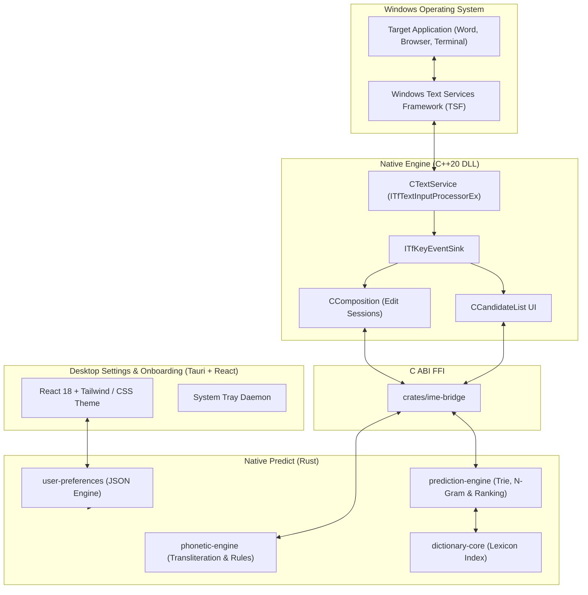

# Native Bangla Architecture Overview

**Native Bangla — Type Naturally. Write Beautifully.**

Native Bangla is built with a hybrid native systems architecture engineered for sub-5ms keystroke latency, uncompromising privacy, and deep integration with the Windows input subsystem.

## Architectural Layers

## Core Subsystems

### 1. Windows IME (`native/windows-ime`)
- Implemented in ISO C++20 as an In-Process COM server registered with Windows Text Services Framework (`ITfInputProcessorProfiles`).
- Avoids legacy `SendInput` or `keybd_event` backspace hacks. All text insertions and replacements occur via atomic TSF Edit Sessions directly on document text ranges (`ITfRange`).
- Dispatches Latin keystrokes synchronously through `ITfKeyEventSink::OnKeyDown`.

### 2. Linguistic Engine (`crates/phonetic-engine`)
- Deterministic, contextual Bengali phonetic parser matching standard Avro conventions.
- Handles complex conjuncts (যুক্তবর্ণ), vowel signs (কার), hasanta suppression, and special characters (য-ফলা, র-ফলা, রেফ, ৎ, ং, ঃ, ঁ).
- Automatically converts English digits to Bengali digits (`০–৯`) and period to Danda (`।`) when configured.

### 3. Prediction & Learning (`crates/prediction-engine` & `crates/dictionary-core`)
- Trie-based fast prefix matching across core Bengali vocabulary.
- Statistical bigram context model predicting next words dynamically based on previous sentence context.
- Local user dictionary that records word selections offline with frequency decay.

### 4. Desktop Application (`apps/desktop`)
- Elegant, fluid user interface built with React 18, TailwindCSS, and Framer Motion.
- Provides visual keyboard layout inspectors, candidate bar appearance customization, shortcut management, dictionary editor, and first-run onboarding.
